# Messenger for PSP

An independent homebrew client for self-hosted [Stoat API 0.15.1](https://github.com/stoatchat/self-hosted).
Hardware target: **PSP-3000 with 6.61 ARK-4**.

- Browse servers, channels, direct messages and group chats.
- Send and reply to messages, add Unicode or custom emoji reactions, and share photos from the Memory Stick.
- View attachments and profiles, manage friends, and choose notifications and colours.
- Join voice calls with the built-in microphone, per-person volume and mute controls. Voice uses direct IPv4 UDP.

## Install

1. Extract the release ZIP and copy `messenger_psp_client` to `PSP/GAME/`.
2. Set `api_url` in `PSP/GAME/messenger_psp_client/config.ini` to the HTTPS API base of your server, for example `https://chat.example.org/api`. Use the API endpoint instead of the web app address.
3. Enable WLAN, launch **Messenger** from XMB and sign in. Sessions and settings are saved under `PSP/SAVEDATA/MSGP00001DATA`.

Keep your SAVEDATA private because it contains the account session.

## Screenshots

<table>
<tr>
<td>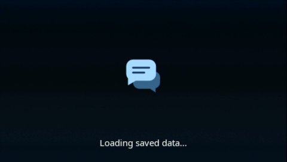</td>
<td>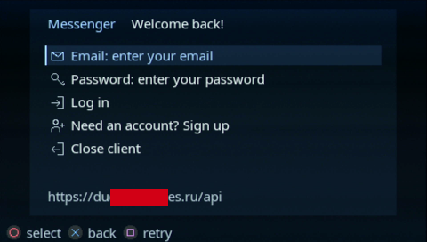</td>
<td>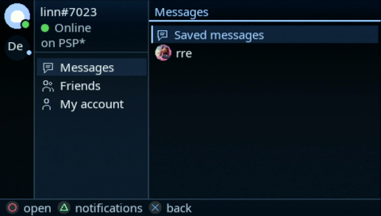</td>
</tr>
<tr>
<td>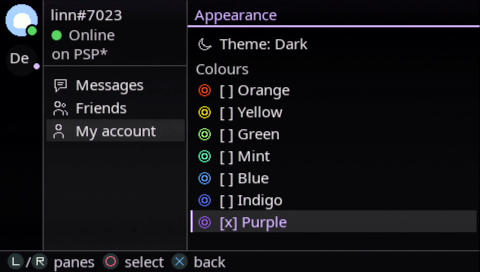</td>
<td>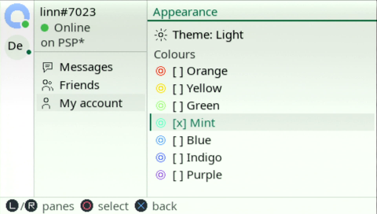</td>
<td>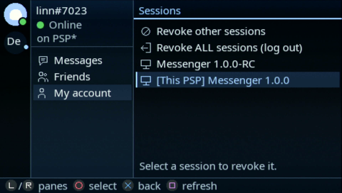</td>
</tr>
<tr>
<td>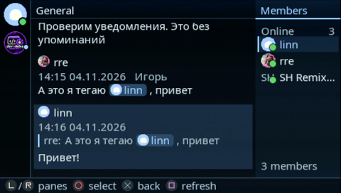</td>
<td>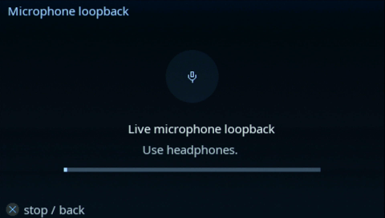</td>
<td>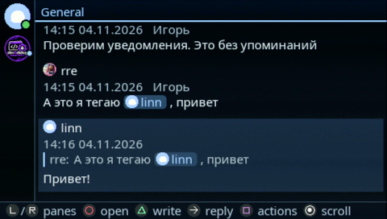</td>
</tr>
<tr>
<td>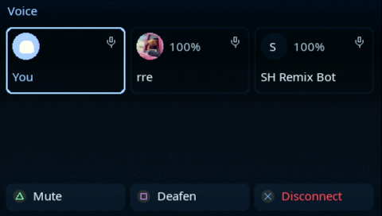</td>
<td>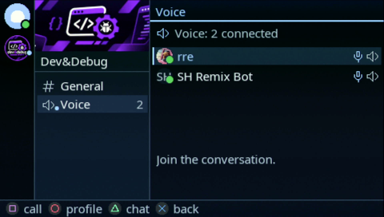</td>
<td>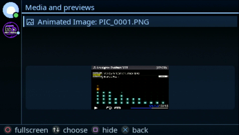</td>
</tr>
<tr>
<td>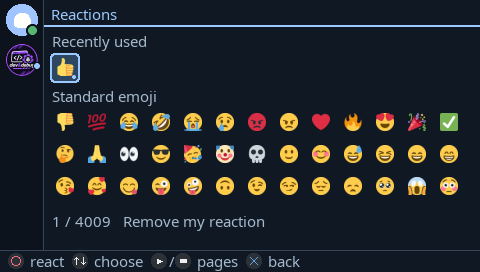</td>
<td>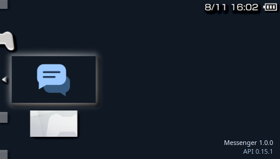</td>
<td>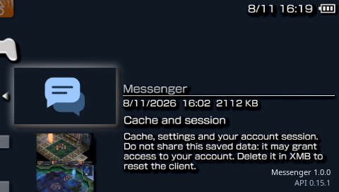</td>
</tr>
</table>

## Build

Install [PSPDEV v20260701](https://github.com/pspdev/pspdev/releases/tag/v20260701) with its PSP libraries. On the host, install Make, a C compiler, CMake, Python 3, pkg-config and the FreeType, libpng and cJSON development packages. The dependency versions and relinking instructions are in [vendor/README.md](vendor/README.md).

```sh
export PSPDEV=/path/to/pspdev
export PATH="$PSPDEV/bin:$PATH"
make package
```

The install folder is `dist/messenger_psp_client/`. The vendored dependencies are built locally from their source archives.

## License

Messenger source and original artwork are licensed under [AGPL-3.0-only](LICENSE).
Bundled fonts, emoji, certificates and libraries retain their own licenses. See [third-party notices](licenses/NOTICE.md).
Download the source archive alongside the matching release ZIP when you need the source for that binary.
